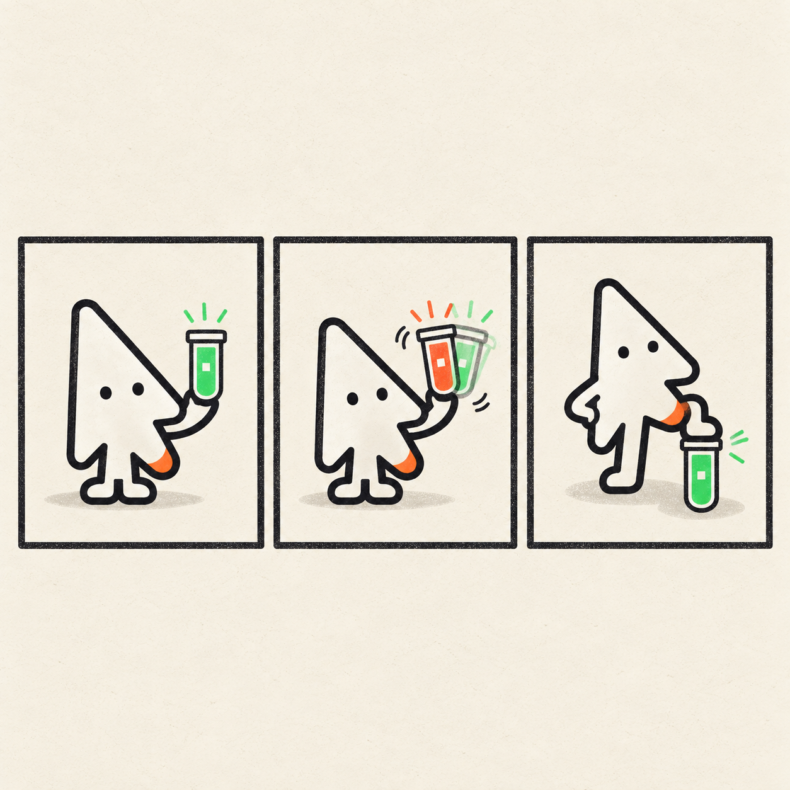
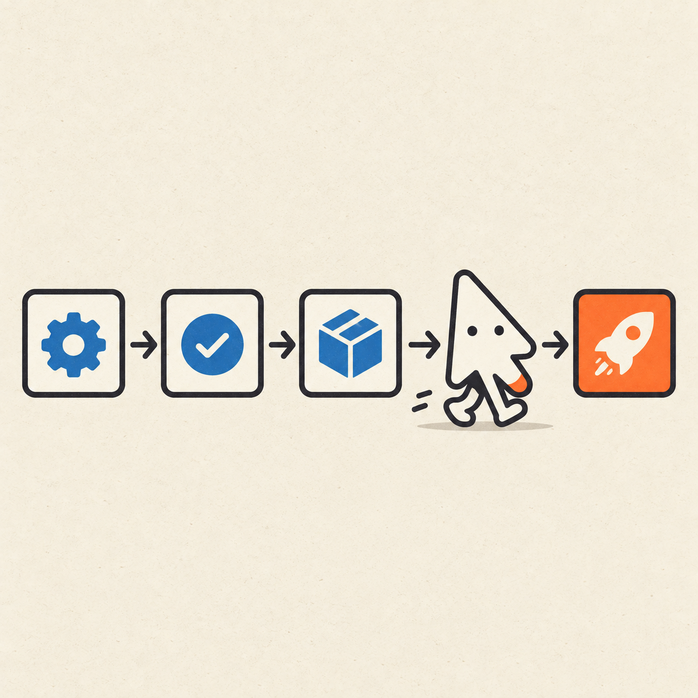
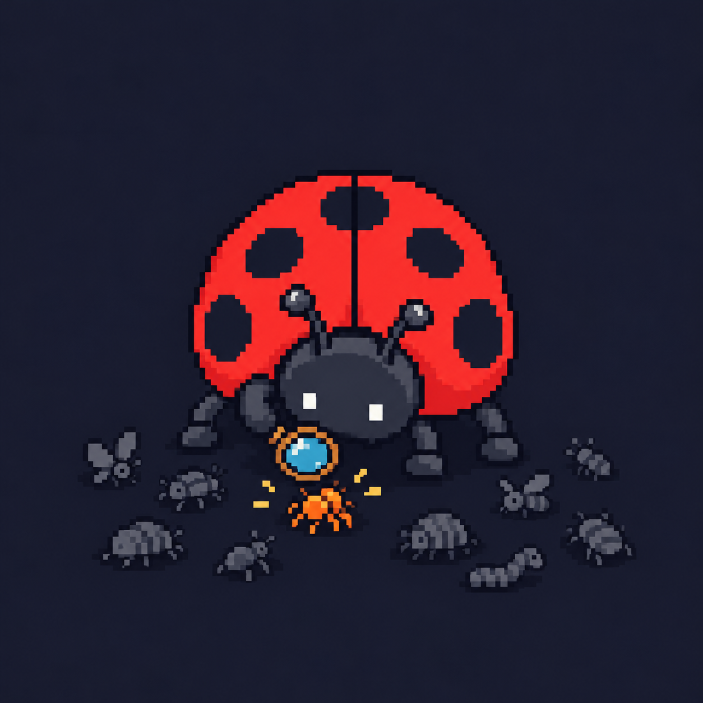
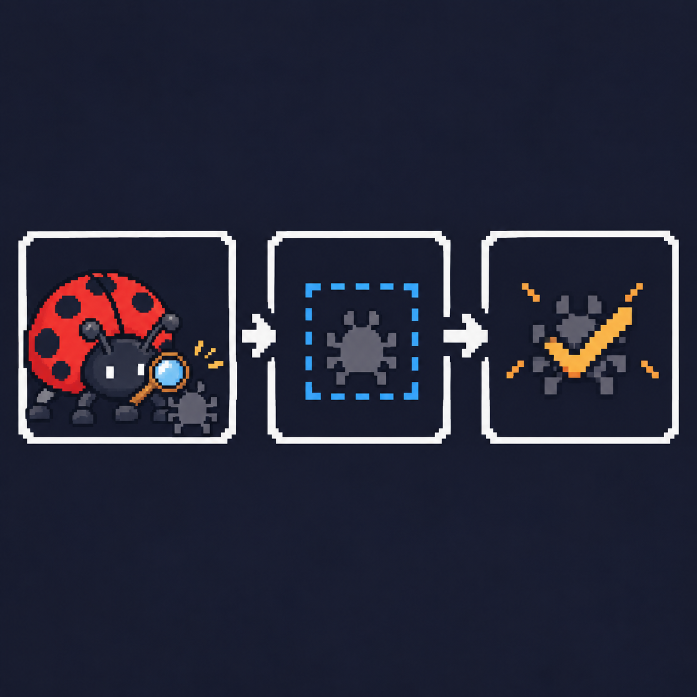

# Sketsa

Editorial-illustration agent skill for Claude Code, Codex, and friends — with a
**character pack system**. The foundation is free and open source; original
character packs are the paid product.

```
/sketsa we shipped dark mode today
/sketsa --character klik explain our deploy pipeline as a mini-comic
```

## What it does

Turns an idea, changelog entry, or article into finished editorial
illustrations: a recurring mascot performing the scene, locked to a strict
visual style, verified on-model by machine before you ever see the result.

- **8 styles** (riso, blueprint, pixel, chalk, woodcut, gouache, phosphor,
  snes), **4 layouts** (editorial, flowchart, mini-comic, explainer)
- **Transparent cutouts** on any engine (chroma-key pipeline)
- **Character builder** — a guided flow from concept to an installed pack
- **Surprise mode** — `/sketsa surprise` picks a dev moment for you
- **Doctor** — one command prints which engines are usable right now
- **Diagram routing** — charts of your own systems build as SVG/Mermaid,
  never hallucinated as images

## How it works

1. **Spec** — your request becomes a shot matrix (`illo-build/shots.csv`):
   one row per illustration, each with concept, palette, and status.
2. **Generate** — each pending shot is generated via your own API key
   (Gemini "Nano Banana" or OpenAI `gpt-image-1`), with the character's
   reference sheet passed for on-model consistency.
3. **Verify** — an edge-map parity score compares every result against the
   character's model sheet. Below the threshold it regenerates, twice max.
4. **Gate** — nothing is delivered until every shot passes the quality gate.

Runs are resumable: only unfinished shots are regenerated.

## Gallery

Every image below was produced by this skill's own pipeline (spec → generate
→ on-model verify → gate) with the codex engine.

| | | |
|---|---|---|
|  |  |  |
| _Klik · deploy day (editorial)_ | _Klik · the flaky test (mini-comic)_ | _Klik · deploy pipeline (flowchart)_ |
|  |  |  |
| _Bugsi · triage (editorial)_ | _Bugsi · reproduce → isolate → fix (explainer)_ | _Garuda · building the nest (editorial)_ |
|  |  |  |
| _Garuda · shipping worldwide (pack)_ | _Pijar · launch (pack)_ | _Klik · sticker cutout (transparent)_ |

## Install

Any one of:

```sh
# Claude Code (plugin + marketplace)
/plugin marketplace add you/sketsa
/plugin install sketsa@sketsa

# Codex, Cursor, Gemini CLI, Grok — each has a native plugin config in this
# repo (.codex-plugin/, .cursor-plugin/, gemini-extension.json, .grok-plugin/)

# Any agent runtime, via the skills CLI
npx skills add you/sketsa --skill sketsa

# Or just copy the skill folder
cp -R skills/sketsa ~/.zcode/skills/
```

## API keys

Set one of these (Gemini is the default engine — best character consistency,
cheapest):

```sh
export GEMINI_API_KEY=...    # ~$0.02–0.04 / image
export OPENAI_API_KEY=...    # ~$0.08–0.19 / image
```

## Character packs

The built-in mascot **Klik** ships free. Additional original characters are
sold as packs (see [`../illo-packs`](../illo-packs) for the first one,
**Bugsi** the pixel debugger). Pack format and authoring checklist:
[`skills/sketsa/characters/PACK-SPEC.md`](skills/sketsa/characters/PACK-SPEC.md).
A pack is three files and a registry entry:

```
packs/<name>/
├── character.md   # locked design + interaction model + prompt spec + value rules
├── reference.png  # canonical model sheet (the on-model anchor)
└── preview.png    # marketing image
```

## Layout

```
skills/sketsa/
├── SKILL.md            # the workflow the agent follows
├── references/         # style guide index + per-style files, layout
│                       # playbooks, quality bar, prompt recipe, builder,
│                       # cutout, surprise, backends
├── characters/         # built-in character + PACK-SPEC.md
├── scripts/            # generate.mjs (the only online script), spec.py,
│                       # onmodel.py, gate.py, pack.py, cutout.py,
│                       # doctor.py — stdlib-only Python tools
└── tests/              # unit tests for every script
```

## Selling packs?

See [`docs/monetize.md`](docs/monetize.md) — store setup, license activation
(Gumroad/Lemon Squeezy), the paid-pack gate, and a launch playbook.

## License

MIT — see [LICENSE](LICENSE). Pack assets are sold separately.
